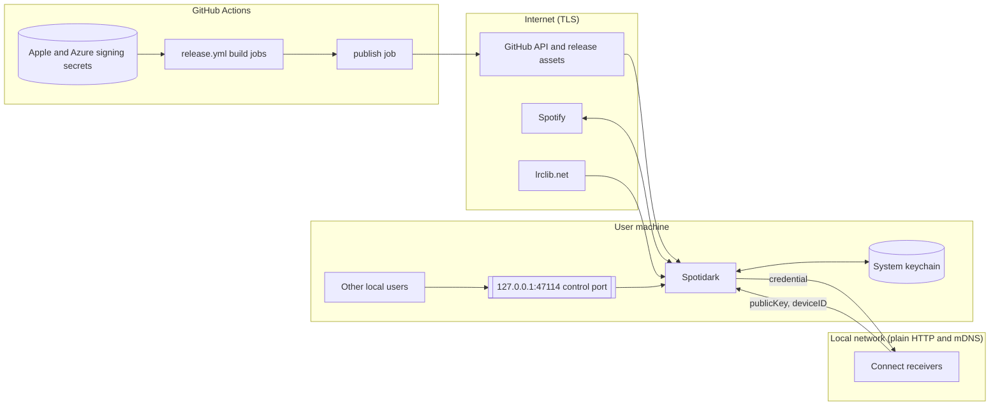

# Full audit, 2026-10-20

Reviewed on macOS (Apple M1 Max, Rust 1.98.0) against the working tree of
`ci/windows-authenticode-signing` at `27ecac7` plus its staged changes, which
sit on top of `main` at `901d1a7`. Line numbers below refer to that tree; code
that exists only in the staged changes is marked **staged**.

Modes run: Codebase (two slices), Threat model, Tests, Docs, Performance, Debt.
Motion and SEO were skipped: the app has no web animation stack, and the docs
site is not deployed from this repository. Fixes for the findings marked
**fixed** are in the same change as this record.

## Coverage

This was a sampled audit, not a line-by-line read. Code that no reader opened
was not judged, so "no finding" there means nothing.

| Reader | Read in full | Skipped or skimmed |
| --- | --- | --- |
| Codebase, app and UI | `src/app.rs` production code, `src/model.rs`, `src/ui/sidebar.rs` | `src/demo.rs`, `src/ui/collection.rs` (staged), `src/ui/widgets.rs`, `src/ui/settings.rs`, `src/ui/winamp/*`, `src/theme*` |
| Codebase, backend and dependencies | `auth.rs`, `history.rs`, `lyrics.rs`, `liked.rs`, `sink.rs`, `api/client.rs`, most of `backend.rs` | `backend.rs` lines 1285-1585, 1990-2974, 3125-3780; `single_instance.rs`, `zeroconf.rs`, `credentials.rs`, `updates/*` skimmed |
| Threat model | updater, OAuth, link handling, artwork decoding, ZeroConf hand-off, control port, workflows | `src/api/**`, `src/skin/**` (`.wsz` parsing), `theme/custom.rs`, MilkDrop child and shared memory, `build.rs`, packaging scripts, the librespot and projectm forks |
| Tests | about 40% of `app.rs` tests; settings, history, http, theme, entrypoint, branding tests | test bodies in `demo.rs`, `backend.rs`, `images.rs`, `credentials.rs`, `updates/*`, `single_instance.rs` read by name only; `tests/localization.rs`, `tests/omarchy.rs` not opened |
| Docs | README, CONTRIBUTING, `docs/releases.md`, `settings-and-files.md` | other guides checked by grep; `queue.md` not checked against the queue tests |
| Performance | measured build, test, startup, binary size, CI | idle CPU of a signed-in app; Nix job breakdown |

## Summary

| ID | Severity | Area | Finding | Status |
| --- | --- | --- | --- | --- |
| T-H1 | High | CI supply chain | Release jobs holding the signing secrets run third-party actions pinned to movable tags | fixed |
| D-H1 | High | Docs | The `docs/` site, guides and data files describe upstream Spotifast and its downloads | fixed |
| D-H2 | High | Docs | `settings-and-files.md` gives Fastpotify paths, log name and keychain service | fixed |
| D-H3 | High | Docs | Bug-report forms point at log files that do not exist | fixed |
| D-H4 | High | Docs | The CLI is documented as three flags; about twenty control subcommands are undocumented | fixed |
| D-H5 | High | Docs | Getting-started gives the wrong Connect device name and desktop file | fixed |
| CA-H1 | High | Optimistic UI | Following, unfollowing or editing a playlist empties and regrows the sidebar list | fixed |
| CB-H1 | High | Sign-in | An idle connection to the OAuth redirect port hangs sign-in indefinitely | fixed |
| T-M1 | Medium | Updater | Update integrity rests only on GitHub release write access | open, by design |
| T-M2 | Medium | LAN hand-off | The account credential goes to whichever device answered, with no identity check | partly fixed |
| CA-M1 | Medium | Optimistic UI | A failed queue refresh replaces the loaded queue with an error | fixed |
| CA-M2 | Medium | Optimistic UI | Renaming a playlist is not shown until Spotify answers, and drops the loaded page | fixed |
| CA-M3 | Medium | Optimistic UI | A failed unfollow does not bring the playlist back | fixed |
| CA-M4 | Medium | Scheduling | The hidden-window waiter depends on every producer waking it (**staged**) | open |
| CA-M5 | Medium | Structure | `src/app.rs` is 18,903 lines with about 170 fields on `App` | open |
| CB-M1 | Medium | Backend | Cache writes are awaited inline on the worker loop, so player commands wait behind them | fixed |
| CB-M2 | Medium | Data loss | `history.json` is written non-atomically and reset on any parse error | fixed |
| CB-M3 | Medium | Disk | Artwork, lyrics and playlist caches never shrink | fixed |
| CB-M4 | Medium | API | A long `Retry-After` is clamped to 30 s, so the app probes during a ban | fixed |
| CB-M5 | Medium | Structure | `src/backend.rs` is 5,186 lines and carries test-only recorders | open |
| CB-M6 | Medium | Audio | A stalled output device blocks the sink's write forever | fixed |
| D-M1..M6 | Medium | Docs | Omarchy hook names, demo-mode lists, CONTRIBUTING release policy, in-app upstream links, Spotifast framing, repeated facts | fixed |
| XI-1 | Medium | Tests | About 100 parallel tests share one temporary directory | fixed |
| XT1-3, XT10-1 | Medium | Tests | Font fallback tests cannot fail; a history test reimplements the code it tests | fixed |
| P-M1 | Medium | CI | The Nix job takes 26 to 29 minutes and sets the length of every run | open |
| P-M2 | Medium | Tests | `demo` and `app` tests are 80% of test CPU time | open |
| T-L1 | Low | Local IPC | The control port accepts any local user | open, question |
| T-L2 | Low | Supply chain | MilkDrop preset archives follow a moving `master` with no hash | fixed |
| T-L3 | Low | Supply chain | Git dependencies follow branches instead of commits | fixed |
| CA-L1..L4, CB-L1..L6 | Low | Various | See below | fixed except CB-L5 |
| XT1-1, XT1-2, XT3-1, XT6-1..3, XT15-1, XT15-2 | Low | Tests | Assertion-free, duplicate or misnamed tests | fixed |
| P-L1, P-L2 | Low | Performance | Demo window CPU while static; three identical 24 MB binaries | open |

Debt: the repository has no `SHORTCUT:` markers. Nothing to report.

## Threat model

Assumptions: a single-user desktop app on macOS, Windows and Linux with no
hosted backend. Network peers are Spotify, GitHub Releases, lrclib.net, artwork
CDNs, the local network (mDNS and Connect receivers) and the local control
channel. Attackers in scope are a network attacker, a malicious LAN device,
malicious content, another unprivileged local user, and a compromised CI
dependency. Physical access, root, and malware running as the same user are out
of scope.

The most valuable asset on the client is the reusable playback credential,
which keeps working until Spotify revokes it. The most valuable asset overall is
the ability to publish a release, because installed copies update themselves
from it.

**T-H1, high.** `release.yml` ran `dtolnay/rust-toolchain@stable`,
`Swatinem/rust-cache@v2` and `ilammy/msvc-dev-cmd@v1` before the steps that
receive the Apple and Azure signing secrets, and `spotidark-ci.yml` passed
`secrets: inherit`. A retagged upstream action could rewrite the signing scripts,
take the secrets, and ship a signed build that every install downloads. Fix:
every action in the release workflow is pinned to a commit, the toolchain comes
from `rustup` and `rust-toolchain.toml`, the release jobs build without a shared
cache, and CI passes only the named secrets. Moving signing into its own job and
Azure to OIDC remain open.

**T-M1, medium, by design.** The updater checks GitHub's digest for the release
asset, which protects against the network but not against whoever can publish.
Windows never verifies the Authenticode signature of the download
(`src/updates/install.rs:438`), macOS checks the publisher only when the
installed app has a team identifier, and macOS runs the downloaded binary for a
version check during the background download (`src/updates/macos.rs:132`). This
is documented in `how-it-connects.md`. Open questions: should the Windows
updater require the signer to match the running build once Authenticode
signing is live, and should the version check move to after "Restart to
update"?

**T-M2, medium.** Clicking a LAN receiver encrypts the credential to a public
key the receiver supplied (`src/zeroconf.rs`), as the Spotify ZeroConf protocol
requires. A rogue device advertising a familiar name, or a man in the middle on
plain HTTP, receives a working credential. Fixed here: the hand-off is refused
when the device identity at click time differs from the one seen when the
receiver was found. Open: a one-time confirmation explaining that the device
gets lasting account access. That is an interface change and needs maintainer
approval.

**T-L1, low.** On macOS and Windows the control port at `127.0.0.1:47114`
accepts any local user, who can control playback, read what is playing, or bind
the port first so the next launch hands its links to them
(`src/single_instance.rs:212`). Open question: does the Stream Deck plugin need
TCP? If not, a per-user socket or named pipe closes this.

**T-L2, low.** MilkDrop preset packs were downloaded from `master` archives with
no hash. Fixed: the archives are pinned to commits and checked against a SHA-256.

**T-L3, low.** `librespot-*` and `projectm-sys` followed `crmne` branches.
`Cargo.lock` kept builds reproducible, but `cargo update` would pull whatever
the branch held. Fixed: both are pinned with `rev`. AGENTS.md asks for
maintainer-owned forks; moving them into `darkroomengineering` remains open.

Considered and rejected: OAuth code interception (PKCE and `state` hold),
reflected script on the redirect page (fixed strings only), a web page driving
the control port (the protocol prefix cannot be sent by a browser), path
traversal through link IDs (base62 only), artwork decoding (size and pixel
limits), updater attacks from the network (redirect allowlist, exact asset
match, digest, size cap, private staging), preset archive traversal (base names
only), and workflow injection (no `pull_request_target`, no event text in
`run:`).

## Codebase

Verdict: correct where it was read, with the optimistic-interface contract
broken in the playlist flows. Structure needs work, but the user deferred
splitting `app.rs` and `backend.rs` to a separate change.

**CA-H1, high.** Following, unfollowing or editing a playlist called
`load_playlists`, which set the sidebar list to `Loading`. The sidebar then drew
nothing until page 0 arrived, so every playlist disappeared and came back.
AGENTS.md: "Nothing the user did may ever flicker away and come back." Fixed:
the reload keeps the shown list until the new pages arrive.

**CA-M1, medium.** A failed queue refresh replaced the shown queue with the
error through `Loadable::from_result`. Fixed: a refresh error keeps the loaded
queue, as `Loadable::refresh` already does elsewhere.

**CA-M2, medium.** Renaming a playlist waited for Spotify and then discarded the
loaded page. Fixed: the new name shows immediately and is restored if the
request fails.

**CA-M3, medium.** A failed unfollow left the playlist missing from the sidebar.
Fixed: it comes back with an error message.

**CA-M4, medium, staged.** The staged hidden-window waiter sleeps until a
producer wakes it, and `background_deadline` mirrors the tick schedule by hand.
A producer that forgets to wake it (the control port and the macOS menu were not
checked) leaves work waiting. This code is not on `main`, so it is not fixed
here.

**CA-M5 and CB-M5, medium.** `src/app.rs` is 18,903 lines (9,400 of them
production code); `apply` is about 1,070 lines and `handle_api` about 1,260.
Nine other files pass 1,000 lines. `src/backend.rs` keeps test-only recorders
in the production struct. Recommended direction, deferred: split `apply` and
`handle_api` by domain, give the nine hand-rolled optimistic holds one shared
type, and move the test recorders behind `cfg(test)`.

**CB-H1, high.** `wait_for_code` in `src/auth.rs` read the request line outside
its cancellation and deadline `select!`, with no timeout or length cap. A
browser's idle pre-connection to the redirect port therefore hung sign-in and
kept the port bound. Fixed: each connection has a short timeout and a size cap,
inside the cancellable section.

**CB-M1, medium.** Playlist and liked-songs cache writes were awaited on the
worker loop, and the liked-songs checkpoint rewrote the whole file every 500
rows. Fixed: the writes run off the loop.

**CB-M2, medium.** `history.json` was written with `std::fs::write`, cleared its
dirty flag before writing, and reset to empty on any parse error. Fixed: atomic
write, the flag clears only after success, and an unreadable file is kept as
`history.json.bad` instead of being overwritten.

**CB-M3, medium.** The artwork, lyrics and playlist caches had no size limit.
Fixed: a startup pass trims each one.

**CB-M4, medium.** `Retry-After` values were clamped to 30 seconds, so the app
asked again while Spotify was still refusing. Fixed: the cooldown keeps the full
value; only the wait inside a single request is capped.

**CB-M6, medium.** The sink's write waited forever on a stalled output device.
Fixed: it is bounded the same way `stop` already is.

Low findings, all fixed except CB-L5:

- **CA-L1:** the control-port batch reported the playing state from before the
  command.
- **CA-L2:** `lyrics_reduce_motion` was renamed to describe what it controls.
- **CA-L3:** two doc comments were attached to the wrong items.
- **CA-L4:** `play_queue_item` changed the queue before finding there was no
  device.
- **CB-L1:** `Backend::shutdown` joined without a timeout.
- **CB-L2:** the lyrics cache was written non-atomically.
- **CB-L3:** the liked-songs writer leaked its temporary file.
- **CB-L5:** `urlencoding` and `percent-encoding` overlap. Left as is, because
  removing one is a dependency change unrelated to any defect.
- **CB-L6:** preset unpacking had no limit on the number of entries.

Dependencies: no crate is dangerously old. `windows-sys` 0.60 and 0.61, two
RustCrypto generations, and `mdns-sd`/`hyper-util` lag come from librespot and
eframe, so they are left until those move.

## Tests

The queue, optimistic-interface, playlist-availability, credential-privacy and
backend concurrency tests are strong and are kept as contracts.

**XI-1, medium.** `headless_app()` gave about 100 parallel tests the same
directory. `save_session` in one test and `clear_disk_cache` in another could
change what a third test loaded. Fixed: each call gets its own directory.

**XT1-3, medium.** The emoji and CJK font tests asserted only a minimum glyph
count, which Latin letters alone satisfy. Fixed: they check that the fallback
glyphs resolve.

**XT10-1, medium.** `counting_never_overflows_however_long_a_song_runs`
reimplemented the counting logic in the test. Fixed: it now drives the
production code.

Low, fixed:

- **XT1-1:** a `http.rs` test with no assertions was deleted.
- **XT1-2:** a `system_fonts.rs` test with no assertions was deleted.
- **XT3-1:** shortcut label tests now check labels against the bound keys.
- **XT6-1:** five settings round-trip tests became one table.
- **XT6-2:** a duplicated decoration test was deleted.
- **XT6-3:** a duplicated session-read block was reduced to its unique
  assertion.
- **XT15-1:** the frame-rate dial test now clicks the dial.
- **XT15-2:** the branding rename test now loads a settings file in the old
  layout.

Coverage gaps closed by new tests:

- unreadable `settings.json`;
- atomic settings save;
- `migrate_proxy` for HTTP and malformed URLs;
- history file recovery.

Gaps still open:

- relaunch after an update install;
- a stale control-port listener;
- second-instance hand-off on macOS and Windows;
- OAuth `state` mismatch.

## Docs

The `docs/` tree described upstream Spotifast 0.8.0: its site config, download
page and data files linked `crmne` releases, Homebrew, AUR and Flatpak packages
this fork does not publish. Reference pages gave `fastpotify` paths, a
`fastpotify.log` file, the `rocks.fastpotify.Fastpotify` keychain service, a
`playerctl --player=fastpotify` command, and a Connect device named Spotifast.
The bug-report forms sent reporters to the same nonexistent log paths.

Fixed: every page now uses the names from `src/paths.rs`,
`src/credentials.rs`, `src/mpris.rs` and `src/settings.rs`. The download guide
lists only `spotidark-macos.dmg`, `spotidark-windows.exe` and a source build.
The CLI reference covers every subcommand. "Since 0.8.0" wording is gone.
Spotifast's MIT notice and credit are kept. `docs/CNAME` no longer claims
upstream's domain. Publishing the site is not set up and needs a maintainer
decision.

## Performance

All numbers are from this machine. Commands were run three times where noted.

| Measurement | Command | Result |
| --- | --- | --- |
| Cold dev build | `cargo build --locked --offline` | 210 s (n=1) |
| No-op build | same | 0.46 s median (n=3) |
| Rebuild after touching `src/app.rs` | `touch src/app.rs; cargo build --locked --offline` | 3.87 s median, 3.81 to 3.87 (n=3) |
| Test run, already built | `cargo test --locked --offline --all-targets` | 54.1 s median, 51.2 to 59.9 (n=3); 804 passed, 1 ignored |
| Cold release build | `cargo build --release --locked --offline` | 218 s (n=1) |
| Release binary size | `ls -l target/release/spotidark` | 24,275,376 bytes |
| Startup to first frame | `spotidark --demo-shot out.png --demo-shot-delay 0` (release, `demo`) | 0.51 s median warm (n=3) |
| Peak memory, demo Home | `/usr/bin/time -l` with an 8 s delay | 276 to 285 MiB (n=3); no change from the 2026-09-16 baseline of 282 MiB |
| CI run, pull request | `gh run view 35359818312 --json jobs` | 27.8 min; Nix job 1,578 s |
| CI run, main push with release | `gh run view 35234586027 --json jobs` | 41.6 min; Nix job 1,753 s |

**P-M1, medium.** The Nix job is 3 to 6 times longer than any other CI job, and
it alone sets how long every run takes. Its log was not inspected, so the cause
(vendoring, compiling or cache misses) is open.

**P-M2, medium.** Run one at a time, the `demo` and `app` test modules take
38.6 s and 38.1 s of the 95.9 s total. The seven slowest tests are the
translated-UI and drag tests, at 2.2 to 3.0 s each. Building the app crate with
`opt-level = 1` in the test profile is the first thing to try, with an A/B
timing.

**P-L1, low.** The demo window on a static Home screen used about 0.55 of a core,
but the demo state is "playing", so continuous repaint may be correct. A signed-in
idle measurement is still needed.

**P-L2, low.** `spotidark`, `spotifast` and `fastpotify` are three identical
24 MB executables. README documents the compatibility names as intentional,
and only `spotidark` is packaged, so this costs build time only.

Not reproduced: the 2026-09-16 follow-up's note that the default test suite
exhausts macOS file descriptors. This shell's limit is 1,048,576, so the test
does not show whether that is fixed.

## Open questions for the maintainer

1. Does the Stream Deck plugin, or anything else, depend on TCP port 47114?
2. Should the Windows updater require the downloaded installer's Authenticode
   signer to match the running build?
3. Should there be an update-signing key kept off GitHub?
4. Is `main` protected? Every push to it publishes a signed release to all
   installs.
5. What may `crmne/copilot-triage` do with issue text (labels, close, edit)?
6. Should LAN receivers ask for confirmation before the first hand-off?
7. Should the docs site be published, and on which domain?
